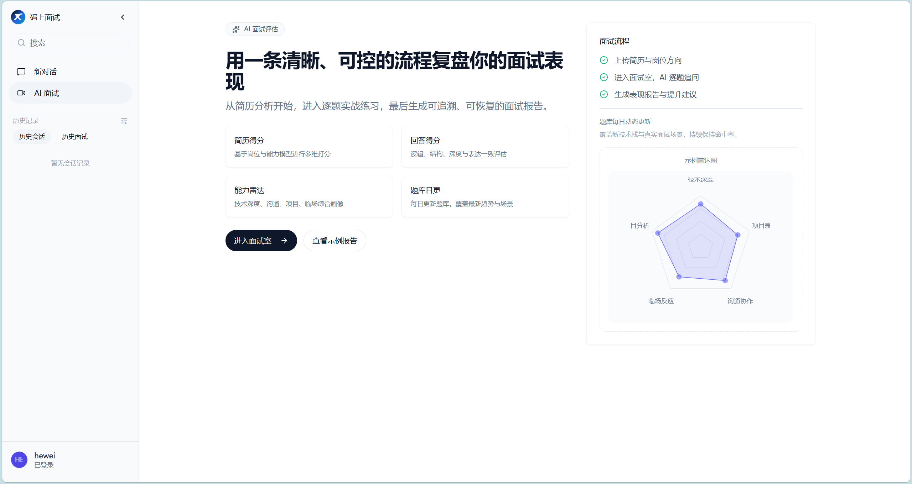

# AI 面试评测平台（Xunzhi Agent）

基于大语言模型（LLM）的 AI 面试平台：上传简历后自动解析并生成面试题，候选人在线答题（文字 / 语音），AI 自动评分与追问，最终生成面试报告。

**核心解决的问题**：LLM 调用**慢、贵、不稳定**。因此本项目的主要工程投入在 **流式响应、调用防护、幂等去重** 三块，而不是业务 CRUD。



---

## 技术栈

| 分类 | 技术 |
|---|---|
| 语言 / 运行时 | Java 17 |
| 框架 | Spring Boot 3.4.4、Spring Cloud 2024.0.0 |
| AI | Spring AI 1.0.0（OpenAI 兼容协议 / DeepSeek） |
| 容错 | Resilience4j（TimeLimiter / Bulkhead / CircuitBreaker / Retry） |
| 规则编排 | LiteFlow |
| 存储 | MySQL 8（MyBatis-Plus）、Redis、MongoDB |
| 实时通信 | SSE（Server-Sent Events）、WebSocket |
| 其他 | Sa-Token（鉴权）、Micrometer（指标） |

---

## 核心设计

### 一次 AI 调用的完整链路

```
业务 Service（出题 / 评分 / 追问 / 神态）
        ↓
InterviewAiInvoker.guardedCall          ← 统一入口
        ↓
① SingleFlight 去重                     ← 同一任务只真正执行一次
   ├─ 命中 → 等待 / 回放结果
   └─ 未命中 ↓
② AiCallGuardService 四道防线            ← 按 stage 独立配置
   ├─ 熔断（快速失败）
   ├─ 舱壁（并发上限）
   ├─ 重试（只对超时 / IOException）
   └─ 超时（专用线程池，单次计时）
        ↓
③ 调用 AI 模型
        ↓
④ SSE 流式回传（FluxSink.next 逐段推送）
```

### 四个关键设计点

**1. 防护链的嵌套顺序：熔断 → 舱壁 → 重试 → 超时**

- 熔断在最外层：跳闸时快速失败，不占并发许可、不浪费时间重试
- 舱壁在重试外层：一次业务调用只占一个并发许可，重试绕不过并发上限
- 重试在舱壁内层：熔断拒绝 / 舱壁满在更外层抛出，进不了重试逻辑
- 超时在最内层：每次尝试单独计时，总耗时上限 = 单次超时 × 最大尝试次数

**2. 按 stage 隔离故障域**

`INTERVIEW_EVALUATION` / `FOLLOWUP` / `EXTRACTION` / `DEMEANOR` 各自独立的熔断器与舱壁，避免一个慢场景把全部功能拖挂。

**3. 两层幂等**

| | 存储 | 幂等键 | 防的是什么 |
|---|---|---|---|
| 接口层 | Redis `SETNX` | `sessionId + requestId` | 同一条请求被重复提交 |
| AI 调用层 | 单飞（本地 Map / Redis+Lua） | `stage \| sessionId \| questionNo \| SHA256(answer)[0:16]` | 同一个任务被重复执行 |

接口层三态：`NEW`（继续执行）/ `PROCESSING`（提示处理中）/ `SUCCEEDED`（直接回放结果）。

**4. 降级策略**

LiteFlow 规则引擎异常时 `fail-open`：退回"AI 是否建议追问 + 追问次数是否超限"两条最简规则，保证面试流程不中断，代价是判断精度下降。

---

## 快速开始

### 环境要求

- JDK 17+
- Maven 3.8+
- MySQL 8.0+
- Redis 6+
- MongoDB 5+

### 1. 初始化数据库

```bash
mysql -u root -p -e "CREATE DATABASE mianshi_agent DEFAULT CHARSET utf8mb4;"
mysql -u root -p mianshi_agent < docs/sql/schema.sql
```

### 2. 配置环境变量

支持通过环境变量覆盖配置，也可直接修改 `admin/src/main/resources/application.yaml`。

| 变量 | 说明 | 默认值 |
|---|---|---|
| `SERVER_PORT` | 服务端口 | `8002` |
| `MYSQL_HOST` / `MYSQL_PORT` | MySQL 地址 | `127.0.0.1` / `3306` |
| `MYSQL_DATABASE` | 数据库名 | `mainshi_agent` |
| `MYSQL_USERNAME` / `MYSQL_PASSWORD` | 数据库账号 | 需自行配置 |
| `REDIS_HOST` / `REDIS_PORT` | Redis 地址 | `127.0.0.1` / `6379` |
| `MONGODB_HOST` / `MONGODB_PORT` | MongoDB 地址 | `127.0.0.1` / `27017` |
| `MONGODB_DATABASE` | MongoDB 库名 | `xunzhi_agent` |
| `XUNFEI_API_KEY` / `XUNFEI_API_SECRET` | 讯飞开放平台密钥 | 需自备 |

> **安全提示**：仓库中的密钥均已替换为占位符（`YOUR_XUNFEI_API_KEY` 等），运行前需自行填入，**请勿将真实密钥提交到仓库**。

### 3. 启动

```bash
mvn clean package -DskipTests
java -jar admin/target/*.jar
```

或在 IDE 中直接运行主启动类。

---

## 目录结构

```
admin/
├── src/main/java/com/hewei/hzyjy/xunzhi/
│   ├── ai/                      # AI 对话与流式响应
│   ├── interview/
│   │   ├── application/guard/   # 调用防护（四道防线 + 单飞）
│   │   ├── application/rule/    # LiteFlow 追问决策规则链
│   │   └── flow/answer/         # 答题管线（幂等 → 评分 → 追问决策）
│   ├── media/                   # 语音转写 / 长文本合成
│   └── common/config/sse/       # SSE 配置
└── src/main/resources/
    ├── application.yaml         # 主配置
    ├── liteflow/                # 规则链定义
    └── workflow/                # 各面试环节的 Agent 工作流
```

---

## 致谢

本项目的架构设计参考了开源项目 [AI-Meeting](https://github.com/lishuangqiang/AI-Meeting)（MIT License），感谢原作者的工作。

- 原版权声明：`Copyright (c) 2026 xunzhi-agent-team`，保留于 [LICENSE](LICENSE) 文件
- 本项目在其基础上完成了工程化实现与调整，重点包括 AI 调用链路的流式响应、调用防护与幂等去重

---

## License

[MIT](LICENSE)
